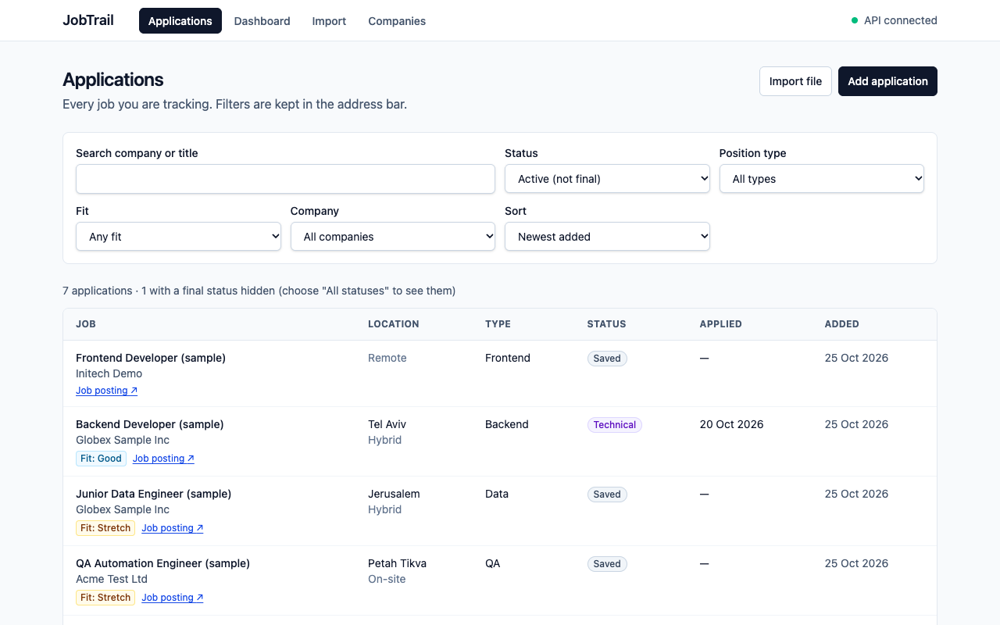
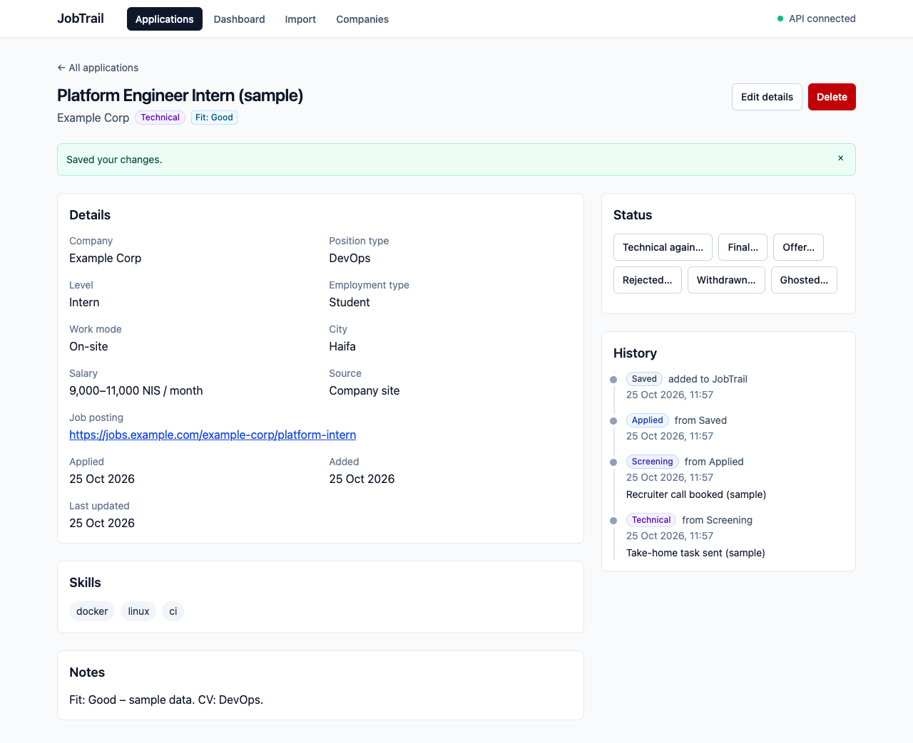
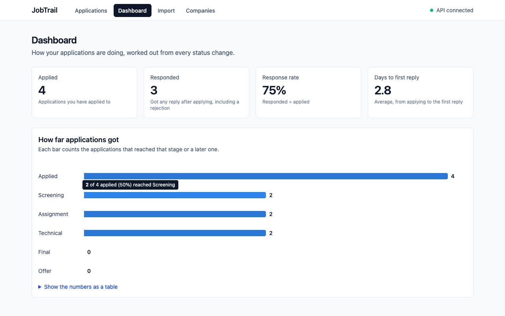
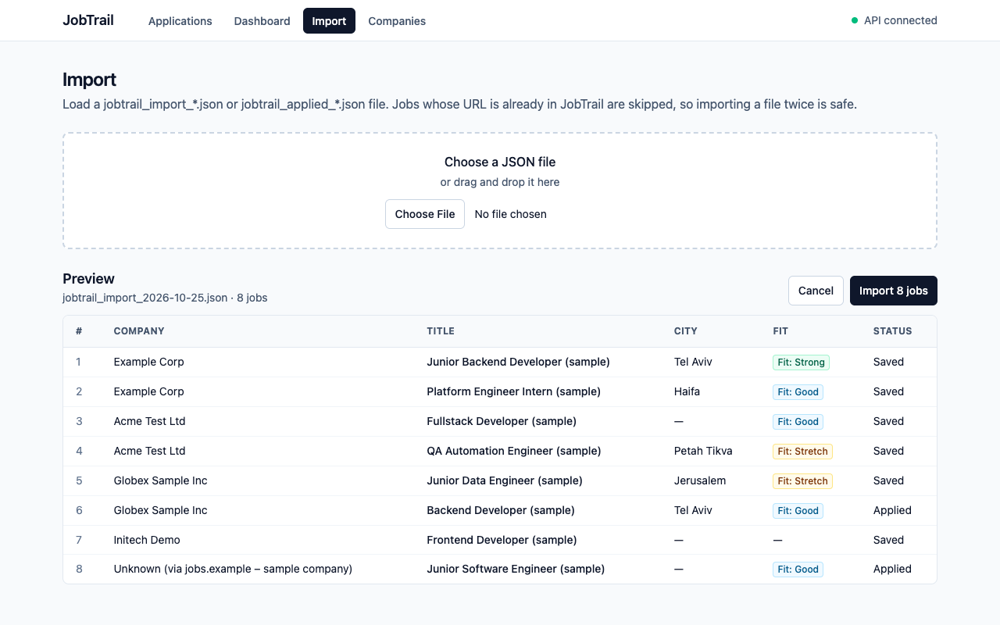
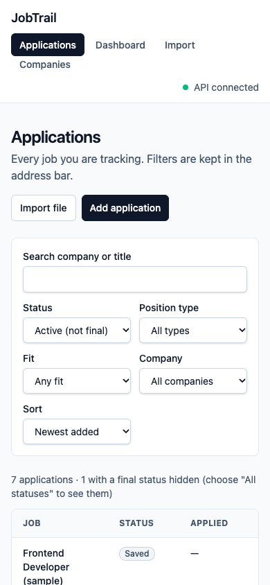

# JobTrail

Job-search management app: a FastAPI backend and a React frontend to track companies, applications and every status change, with rules for which status changes are allowed, a full history of each application, and stats.

**Stack:** Python 3.12 · FastAPI · PostgreSQL · SQLAlchemy 2.0 · Alembic · pytest · React 19 · TypeScript · Vite · TanStack Query · Tailwind CSS · Vitest · Docker · nginx · GitHub Actions
**Planned:** Terraform · AWS

## Screenshots

The screenshots use obviously fake sample data.

| Applications | Application detail |
|---|---|
|  |  |

| Dashboard | Import |
|---|---|
|  |  |



## Features

- **Companies and applications:** create, read, update and delete, with filters by status, company and position type
- **Status flow with rules:** `saved → applied → screening → assignment → technical → final → offer`, plus `rejected`, `withdrawn`, `ghosted`, `accepted` and `declined`. Moves that aren't allowed (e.g. `applied → offer`) are rejected with `409 Conflict`
- **Full history:** every status change is stored with a timestamp and an optional note. A change can't be dated before the latest one (`422`), so the history stays in order. The one exception: applying earlier than the job was added moves the "saved" step back
- **Stats:** response rate, average days to first response and a funnel by stage, all computed from the status history
- **Bulk import:** load job listings from a JSON file in one all-or-nothing request. Re-importing the same file is safe, because `job_url` is unique
- **Validation:** request data is checked by Pydantic (`422`, with the field that's wrong, e.g. `salary_max` for "salary_min must be less than or equal to salary_max"), and the database enforces unique company names, foreign keys and a salary-range check

The web app covers the whole daily routine:

- **Applications** (the home page): a table with status and "Fit" badges, filters for status (by default everything that isn't final), position type, company and fit, a text search and sorting. The filters live in the URL, so a refresh keeps them
- **Application page:** every field, an edit form that sends only the changed fields, status buttons for exactly the moves the backend allows, a one-click "Mark applied now", a status history timeline, and delete
- **Import:** choose or drop the daily JSON file, check a preview, import, and see created / updated / skipped
- **Add application:** a form with a company picker that can also create a new company
- **Companies:** list with application counts, add, edit, and delete (with a plain explanation when a company still has applications)
- **Dashboard:** stat tiles and a funnel chart from `/stats`

## Design

- **Current status + history.** `applications.status` holds the current state for fast filtering, and `status_changes` holds the full history for stats. A single service function (`change_status`) validates the move and updates both in one transaction, so they can never get out of sync.
- **Business rules in Python, in one place.** The allowed moves live in `app/status_rules.py` and are covered by unit tests. The frontend reads them from `GET /meta/status-transitions` instead of keeping its own copy.
- **Migrations with Alembic.** Database changes are versioned in `backend/migrations/`.
- **Typed end to end.** The frontend's TypeScript types (and the lists behind its dropdowns) are generated from the backend's OpenAPI schema, so a backend change that breaks the frontend shows up as a type error.

## Architecture

```text
Browser ── React app (served by nginx on :8080, or Vite on :5173 in development)
   │  fetch + JSON; CORS allows only the configured origins (CORS_ORIGINS)
   ▼
FastAPI API on :8000 ── routers → services → SQLAlchemy ──► PostgreSQL 16
```

- **Frontend:** React Router pages, TanStack Query for loading and caching server data (every change refreshes the queries that show it), a small typed API client in `frontend/src/api/`, Tailwind for styling.
- **Backend:** FastAPI routers, Pydantic schemas, a service layer that never commits (one request is one transaction), Alembic migrations.
- **Docker Compose:** `db` → `migrate` (runs the migrations once) → `api` → `web` (nginx with the built frontend).
- **CI:** GitHub Actions checks the backend and the frontend on every pull request and builds the backend image.

## API

| Method | Path | Description |
|---|---|---|
| `GET` | `/health` | Health check |
| `POST` / `GET` | `/companies` | Create / list companies |
| `GET` / `PATCH` / `DELETE` | `/companies/{id}` | Read / update / delete a company |
| `POST` / `GET` | `/applications` | Create / list applications (`?status=`, `?company_id=`, `?position_type=`, `?job_url=`) |
| `POST` | `/applications/import` | Import a list of job listings from JSON (skips job URLs that already exist) |
| `GET` / `PATCH` / `DELETE` | `/applications/{id}` | Read / update / delete an application |
| `POST` | `/applications/{id}/status` | Change status (validated) |
| `GET` | `/applications/{id}/history` | Status history |
| `GET` | `/stats` | Response rate, average days to first response, funnel by stage |
| `GET` | `/meta/status-transitions` | Allowed next statuses for every status, so clients never copy the rules |

Interactive docs: http://localhost:8000/docs

## Importing job listings

The easiest way is the **Import** page in the web app: choose or drag in a `jobtrail_import_<date>.json` or `jobtrail_applied_<date>.json` file, check the preview, and click **Import**. The same endpoint also works from the command line:

```bash
curl -X POST http://localhost:8000/applications/import -H "Content-Type: application/json" -d @jobtrail_import_2026-10-19.json
```

Each item looks like this (`work_mode` and `city` may be `null`):

```json
{
  "company": "WeDev Technologies",
  "title": "Junior Fullstack Software Developer",
  "position_type": "fullstack",
  "level": "junior",
  "employment_type": "full_time",
  "work_mode": "onsite",
  "city": "Holon",
  "job_url": "https://job-boards.eu.greenhouse.io/wedev/jobs/4871703101",
  "source": "company_site",
  "skills": ["react", "node.js", "mongodb", "sql"],
  "notes": "Fit: Good. CV: FullStack."
}
```

Optional: `"status": "applied"` (default `"saved"`) and `"applied_at"` (defaults to now, only allowed with `"applied"`).

How it behaves:

- **Companies** are matched by exact name and created if missing.
- **Duplicates are skipped:** an item whose `job_url` already exists, or appears earlier in the same file, is not created again.
- **One exception, applied files:** an `"applied"` item whose application already exists and is still `saved` moves it to `applied` (reported as `updated`). An application that is already further along is never moved back; that item is skipped.
- **Status rules still apply:** a new `"applied"` item is created as `saved` and moved to `applied` through the normal status logic, so its history has both steps.
- **The response** counts and lists what happened: `{"created": 2, "updated": 1, "skipped": 1, "updated_urls": [...], "skipped_urls": [...]}`.
- **All or nothing:** the whole file is one database transaction. If anything fails, nothing is saved. Invalid values (for example an unknown `position_type`) are rejected with `422` before anything is written.

### Import the newest file from Downloads

With the API running (locally or with `docker compose up --build`), from the repo root:

```bash
make import
```

This runs `scripts/import_latest.sh`, which:

1. finds the most recently modified `jobtrail_import_*.json` or `jobtrail_applied_*.json` in `~/Downloads`,
2. checks that the API answers on `/health`, and says so clearly if it isn't running,
3. posts the file to `/applications/import` and prints the result:

```text
Importing /Users/you/Downloads/jobtrail_applied_2026-10-19.json
Created: 1
Updated: 1
Skipped: 1
  marked as applied: https://job-boards.eu.greenhouse.io/wedev/jobs/4871703101
  already imported: https://jobs.example/already-applied
```

If the file is rejected, it prints each problem with its position in the file (for example `body.1.position_type: ...` for the second item) and exits with an error. To use another folder or API address, set `JOBTRAIL_IMPORT_DIR` or `JOBTRAIL_API_URL`:

```bash
JOBTRAIL_API_URL=http://localhost:8001 make import
```

### Mark one application as applied

In the web app, open the application and click **Mark applied now** (or **Applied, with a note or date…** to backdate it). From the command line, from the repo root:

```bash
make applied URL='https://job-boards.eu.greenhouse.io/wedev/jobs/4871703101'
```

```bash
make applied URL='https://job-boards.eu.greenhouse.io/wedev/jobs/4871703101' DATE=2026-10-17
```

This runs `scripts/mark_applied.sh`, which finds the application with `GET /applications?job_url=...` and moves it to `applied` with `POST /applications/{id}/status`, so the status rules and history apply as usual. Without `DATE` the current time is recorded; with `DATE` it records noon local time on that day.

- Put the URL in single quotes, because characters like `?` and `&` mean something to the shell.
- If no application has that URL, it says so (import it first with `make import`).
- If the move isn't allowed (for example the application is already `applied`), it prints the current status and the API's reason, and changes nothing.

## Run locally

Requirements: [uv](https://docs.astral.sh/uv/), Docker and Node.js 22.13 or newer.

Backend (http://localhost:8000):

```bash
docker compose up -d db
cd backend
cp .env.example .env
uv sync
uv run alembic upgrade head
uv run uvicorn app.main:app --reload --reload-dir app
```

Frontend (http://localhost:5173), in a second terminal:

```bash
cd frontend
npm install
npm run dev
```

The dev server calls the API at `VITE_API_URL` from `frontend/.env.development` (http://localhost:8000), and the API allows that origin by default. After changing backend schemas, regenerate the frontend's types with `npm run gen:api` (the API must be running).

## Run the full stack with Docker

```bash
docker compose up --build
```

This starts four services in order: `db` (Postgres), `migrate` (runs `alembic upgrade head` once and exits), `api` (the backend, on http://localhost:8000) and `web` (nginx serving the built frontend, on **http://localhost:8080**). Stop a local `uvicorn` first, because both use port 8000.

Two settings come from environment variables:

| Variable | Default | What it does |
|---|---|---|
| `VITE_API_URL` | `http://localhost:8000` | Where the browser finds the API. Vite writes it into the JavaScript at build time, so changing it needs `--build` |
| `CORS_ORIGINS` | `["http://localhost:8080","http://localhost:5173"]` | Browser origins the API accepts (a JSON list) |

```bash
VITE_API_URL=https://api.example.com CORS_ORIGINS='["https://jobtrail.example.com"]' docker compose up --build
```

Both images are built in two stages and run as a non-root user:

- **Backend:** dependencies are installed with uv in a builder stage; only the virtualenv and the code are copied into a slim runtime stage.
- **Frontend:** Node builds the static files; `nginx-unprivileged` serves them on port 8080, with long caching for hashed assets and a fallback to `index.html`, so a refresh on `/applications/42` still works.

## CI

GitHub Actions (`.github/workflows/ci.yml`) runs on every pull request and every push to `main`:

1. **Lint and test:** `ruff format --check`, `ruff check` and `pytest` against a Postgres service container.
2. **Frontend checks:** `npm ci`, then `prettier --check`, ESLint, the TypeScript check, the Vitest tests and the production build.
3. **Build image:** builds the backend Docker image. On pushes to `main` it also pushes it to GitHub Container Registry, tagged with the commit SHA and `latest`.

## Tests

**Backend:** API tests run against a separate `jobtrail_test` database. Each test runs inside a transaction that is rolled back afterwards, so tests never affect each other or your real data.

One-time setup:

```bash
docker compose exec db createdb -U jobtrail jobtrail_test
```

Run:

```bash
cd backend
uv run pytest -v
uv run ruff format --check .
uv run ruff check .
```

**Frontend:** Vitest and Testing Library test each page's main behaviour with the API client mocked, so no backend is needed:

```bash
cd frontend
npm test
npm run lint
npm run typecheck
npm run format:check
```
